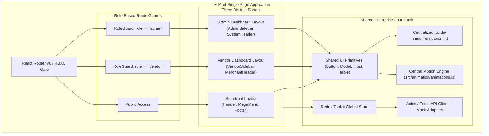
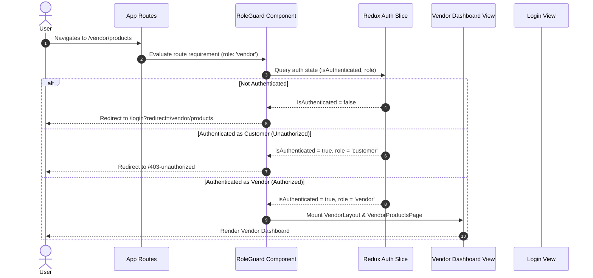
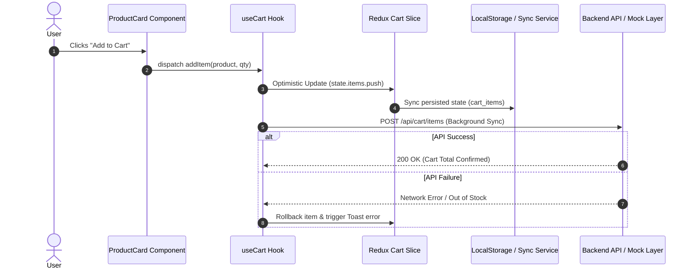
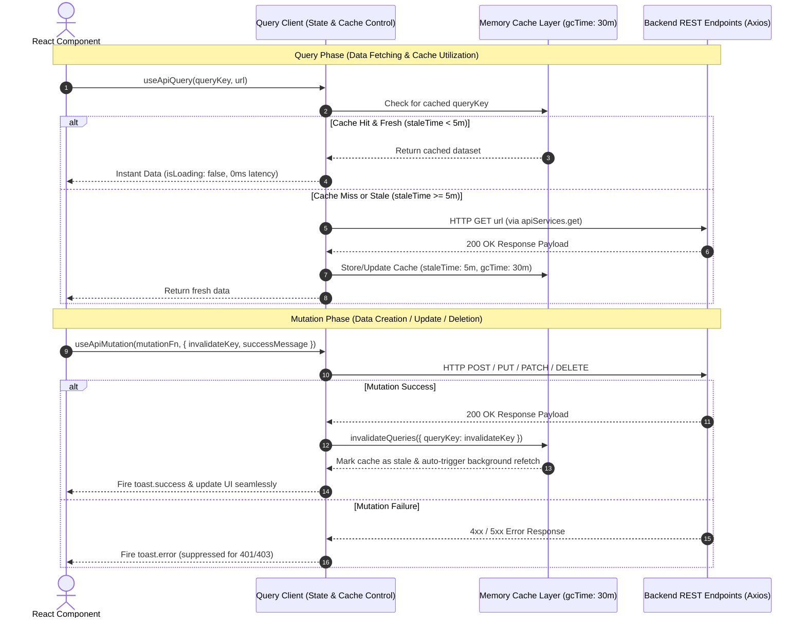

# E-Mart Frontend - System Design & Engineering Architecture

This document defines the production-grade frontend architecture, multi-portal system design patterns (Storefront, Vendor Dashboard, Admin Dashboard), coding constraints, and development guidelines for the E-Mart application.

---

## 1. Core Engineering Principles

### 1.1 Maximum 200 Lines Per File
- **Hard Limit:** No source file may exceed **200 lines of code**.
- **Decomposition Strategy:**
  - Break UI components into atomic sub-components (e.g., `VendorOrderTable` → `OrderRow`, `OrderStatusBadge`, `OrderActionsMenu`).
  - Extract component business logic into custom hooks (e.g., `useVendorStats`, `useAdminApprovals`).
  - Isolate constants, configuration objects, navigation trees, and types into standalone files.

### 1.2 Zero Massive/Noisy Comments (Clean Code Standard)
- **Self-Documenting Code:** Code must express intent through descriptive naming (variables, functions, components) rather than paragraphs of comments.
- **Strict Rules:**
  - ❌ **No massive commentary blocks**, narrative explanations, or conversational notes.
  - ❌ **No commented-out dead code** (rely on git history).
  - ❌ **No redundant comments** explaining self-evident operations.
  - ✔️ **Permitted:** Brief JSDoc annotations for complex domain logic or non-obvious business formulas when strictly necessary.

### 1.3 Centralized Motion & Animations
- **Location:** `src/animation/animations.js`
- **Rule:** Never define inline Framer Motion / Motion variants directly inside JSX components.
- **Exported Primitives:**
  - Standardized transition presets (`springEase`, `smoothEase`, `modalTransition`, `sidebarTransition`).
  - Reusable animation variants (`fadeIn`, `slideUp`, `staggerContainer`, `scaleUp`, `cardHover`).
  - Dynamic helper functions (e.g., `getStaggerDelay(index)`).

### 1.4 Centralized Icon System (`lucide-animated`)
- **Location:** `src/icons/` (Barrel file: `src/icons/index.js`)
- **Rule:** Do not import directly from `lucide-animated` across arbitrary component files.
- **Convention:**
  - `lucide-animated` requires the `Icon` suffix (`HeartIcon`, `CircleCheckIcon`, `CartIcon`, `LayoutDashboardIcon`).
  - Import, customize, and export all icons through `src/icons/index.js` to guarantee consistent icon sizing, strokes, and default animation behaviors.

### 1.5 Mockup Data Layer
- **Location:** `src/mock/`
- **Structure:** Segregated by domain portals:
  - `src/mock/store/` – Catalog, categories, carts, customer orders
  - `src/mock/vendor/` – Vendor products, sales metrics, fulfillment orders, payouts
  - `src/mock/admin/` – Platform users, vendor KYC verifications, platform revenues, audit logs
- **Standard:** Follow strict typed schemas mirroring target production backend REST/GraphQL response payloads to allow zero-effort API integration.

### 1.6 Password Field & Mandatory Section-Level Icon Hover Animation Standard
- **Show/Hide Password Standard:** Every password input field across all portals (Customer, Vendor, Admin) must include an interactive visibility toggle using `EyeIcon` and `EyeOffIcon` from `@/icons`.
- **Autofill Overrides:** Browser autofill must never turn input backgrounds blue; normalized via `:-webkit-autofill` in `src/index.css`.
- **Mandatory Section-Level Icon Hover Animation Standard (Universal Rule):**
  - **No Isolated Icon-Only Hover:** Icons must **never** trigger motion animation only when the cursor touches the isolated icon boundary.
  - **Section/Container Trigger:** Whenever an animated icon exists inside any card, button, link, row, navigation item, or section:
    1. Pass `animateOnHover={false}` to the `<Icon />` element to suppress localized icon self-hovering.
    2. Import and use `useAnimatedIcon` from `src/utils/useAnimatedIcon.js`.
    3. Attach `onMouseEnter={trigger.onMouseEnter}` and `onMouseLeave={trigger.onMouseLeave}` to the parent container/card/section.
    4. Pass `ref={iconRef}` to the animated icon.
  - As soon as the vendor enters or moves their cursor anywhere into the section/card, the icon triggers its animation smoothly and contextually.


### 1.7 Strict Input Field Validation & Sanitization Standard
- **Centralized Helper Location:** `src/utils/validators.js`
- **Real-Time Character Sanitization (Mandatory on `onChange`):**
  - **Name Fields (Full Name, Contact, Owner):** Only letters and spaces permitted (`/[^a-zA-Z\s]/g`). Numbers and special symbols must be strictly blocked as the user types.
  - **Phone Number Fields:** Only numeric digits permitted (`/\D/g`). Letters, symbols, and excess spaces are stripped out immediately.
  - **CNIC / National ID Fields:** Only digits and hyphens permitted, formatted automatically (`XXXXX-XXXXXXX-X`).
  - **Email Fields:** Disallow whitespace and validate standard RFC structure (`user@domain.com`).
- **Rule for Future Development:** Every new input field across the application must strictly adhere to these real-time sanitizers to ensure data cleanliness and eliminate invalid inputs at the source.

### 1.8 TanStack Query Caching & Server State Standard
- **Centralized Engine:** `src/services/queryClient.js`
- **Cache Strategy Configuration:**
  - `staleTime: 5 mins` (`1000 * 60 * 5`) — Fetched server data stays completely fresh in cache. Remounting components or switching dashboard tabs serves instant cached data without showing loading spinners.
  - `gcTime: 30 mins` (`1000 * 60 * 30`) — Unused query caches are retained in memory for 30 minutes before garbage collection.
  - `refetchOnWindowFocus: false` — Eliminates aggressive background refetching when switching OS application windows.
  - `retry: 1` — Failed queries retry once automatically before throwing an error.
- **Query Key Factory:** `src/services/queryKeys.js`
  - All query keys must be declared inside the `QUERY_KEYS` object (e.g. `QUERY_KEYS.PRODUCTS.ALL`, `QUERY_KEYS.ORDERS.DETAIL(id)`).
  - No hardcoded string query keys inside components.
- **Custom Integration Hooks:**
  - `useApiQuery(queryKey, url, options)` in `src/hooks/useApiQuery.js`
  - `useApiMutation(mutationFn, options)` in `src/hooks/useApiMutation.js` (with automatic `invalidateKey` triggering and toast notification).

### 1.9 Zero-Refresh & Instant UI Reflection Standard (Admin & Vendor Actions)
- **Strict Rule:** `window.location.reload()`, hard browser reloads, and manual refresh prompts are **strictly prohibited**.
- **Instant Reflection Requirement:**
  - Whenever an Admin or Vendor updates, creates, or deletes data (e.g. approving/rejecting vendors, toggling product status, editing commission rates, updating profile/store info), the UI must update **immediately and seamlessly** without any page reload.
  - **Enforcement Mechanisms:**
    1. **Automated Query Invalidation:** Trigger `invalidateKey` in `useApiMutation` so TanStack Query immediately re-syncs active view queries with zero downtime or flicker.
    2. **Optimistic UI Updates:** For high-frequency admin actions (status toggles, approvals), mutate local cache via `queryClient.setQueryData()` or `onMutate` for instant 0ms visual feedback.
    3. **State Synchronization:** Keep Redux / local state aligned with server mutations immediately upon resolution.

---

## 2. Multi-Portal System Design Architecture

The E-Mart application operates **3 distinct portals** within a unified frontend codebase:
1. **Customer Storefront:** Public marketplace, product discovery, wishlist, cart, customer account.
2. **Vendor Dashboard:** Merchant portal for inventory control, order fulfillment, payout tracking, and sales analytics.
3. **Admin Dashboard:** Platform governance, vendor onboarding & KYC approval, commission rates, and audit logs.

### 2.1 High-Level Architecture Diagram



### 2.2 Portal Specifications & Access Matrix

| Portal | Base Route | Required Role | Layout Structure | Core Capabilities |
| :--- | :--- | :--- | :--- | :--- |
| **Storefront** | `/` | `guest` / `customer` | `StoreLayout` | Product catalog, cart, checkout, order history |
| **Vendor Portal** | `/vendor` | `vendor` | `VendorLayout` | Product listing/editing, inventory, fulfillment, payouts |
| **Admin Portal** | `/admin` | `admin` | `AdminLayout` | Platform analytics, vendor approval, dispute resolution, user bans |

---

## 3. Client-Side Data & Security Flow

### 3.1 Role-Based Access Control (RBAC) & Route Guard Flow



### 3.2 Optimistic Storefront Data Flow (Cart & Wishlist)



### 3.3 TanStack Query Caching & Invalidation Architecture



---

## 4. Multi-Dashboard Project Directory Structure

```text
E-Mart-Frontend/
├── public/
├── src/
│   ├── animation/                     # Centralized motion engine
│   │   └── animations.js              # Variants, transitions, animation helpers (< 200 lines)
│   │
│   ├── app/                           # Core Redux Store configuration
│   │   ├── store.js                   # configureStore setup
│   │   └── rootReducer.js             # Root reducer combining store, vendor, admin slices
│   │
│   ├── assets/                        # Shared static assets, logos
│   │
│   ├── components/                    # Reusable atomic & layout components
│   │   ├── common/                    # Button, Input, Modal, Drawer, Badge, Spinner
│   │   ├── feedback/                  # Toast, Skeleton, ErrorBoundary, EmptyState
│   │   ├── data-display/              # DataTable, Pagination, StatCard, MetricBadge
│   │   └── navigation/                # SidebarItem, Breadcrumb, Tabs
│   │
│   ├── features/                      # Domain-specific slices & business logic
│   │   ├── auth/                      # authSlice.js, authService.js, useAuth.js
│   │   ├── store/                     # Storefront features (cartSlice.js, wishlistSlice.js)
│   │   ├── vendor/                    # Vendor features (vendorProductSlice.js, vendorOrderSlice.js)
│   │   └── admin/                     # Admin features (adminVendorSlice.js, platformAnalyticsSlice.js)
│   │
│   ├── hooks/                         # Global shared custom hooks & query wrappers
│   │   ├── useApiQuery.js             # TanStack Query GET wrapper with automatic caching
│   │   ├── useApiMutation.js          # Mutation wrapper with auto cache-invalidation
│   │   ├── useDebounce.js             # Search input debounce
│   │   ├── useMediaQuery.js           # Responsive viewport listener
│   │   └── useRole.js                 # Role checks (isVendor, isAdmin, isCustomer)
│   │
│   ├── icons/                         # Centralized animated icons
│   │   └── index.js                   # Re-exported lucide-animated icons
│   │
│   ├── layouts/                       # Distinct portal shell layouts (< 200 lines each)
│   │   ├── StoreLayout.jsx            # Storefront header, search bar, footer
│   │   ├── VendorLayout.jsx           # Vendor collapsible sidebar, store switcher, notifications
│   │   └── AdminLayout.jsx            # Admin sidebar, system metrics header, audit panel
│   │
│   ├── mock/                          # Segregated mock data layers
│   │   ├── store/
│   │   │   ├── products.mock.js       # Customer catalog items
│   │   │   └── categories.mock.js     # Storefront category hierarchy
│   │   ├── vendor/
│   │   │   ├── vendorProducts.mock.js # Vendor inventory & SKU management
│   │   │   ├── vendorOrders.mock.js   # Vendor incoming orders & fulfillment states
│   │   │   └── vendorStats.mock.js    # Revenue, units sold, payout histories
│   │   └── admin/
│   │       ├── platformStats.mock.js  # Platform gross merchandise value (GMV), active users
│   │       ├── vendorApprovals.mock.js# Pending KYC submissions
│   │       └── auditLogs.mock.js      # System security & administrative changes
│   │
│   ├── pages/                         # Route-level views (< 200 lines each)
│   │   ├── store/                     # Storefront views
│   │   │   ├── Home/
│   │   │   ├── Shop/
│   │   │   ├── ProductDetail/
│   │   │   └── Checkout/
│   │   ├── vendor/                    # Vendor Dashboard views
│   │   │   ├── VendorOverview/        # KPI Cards, Recent orders, Low-stock alerts
│   │   │   ├── VendorProducts/        # Product inventory table, Add/Edit modal
│   │   │   ├── VendorOrders/          # Order management, status updater
│   │   │   └── VendorPayouts/         # Bank payout ledger, invoice history
│   │   └── admin/                     # Admin Dashboard views
│   │       ├── AdminOverview/         # Platform KPIs, GMV charts, active vendors
│   │       ├── AdminVendors/          # Vendor approval pipeline, commission settings
│   │       ├── AdminUsers/            # Customer & staff management
│   │       └── AdminSettings/         # Global payment & marketplace configuration
│   │
│   ├── routes/                        # Modular route configuration & guards
│   │   ├── AppRoutes.jsx              # Top-level route tree
│   │   ├── RoleGuard.jsx              # RBAC route protector
│   │   ├── store.routes.jsx           # Storefront route definitions
│   │   ├── vendor.routes.jsx          # Vendor dashboard route definitions
│   │   └── admin.routes.jsx           # Admin dashboard route definitions
│   │
│   ├── services/                      # API clients, network utilities & query caching
│   │   ├── apiBaseURL.js              # Centralized backend API base URL
│   │   ├── apiRoutes.js               # Structured API route definitions
│   │   ├── apiServices.js             # Axios client with interceptors & FormData helpers
│   │   ├── queryClient.js             # TanStack Query client configuration & cache policy
│   │   └── queryKeys.js               # Standardized query keys factory for caching
│   │
│   ├── utils/                         # Pure helper functions
│   │   ├── formatCurrency.js          # Currency formatting
│   │   ├── formatDate.js              # Date & timestamp formatting
│   │   └── storage.js                 # LocalStorage wrapper
│   │
│   ├── App.jsx                        # Route providers & theme context
│   ├── index.css                      # Tailwind CSS & design tokens
│   └── main.jsx                       # React DOM root entry point
├── design.md                          # This architecture specification
├── package.json
└── vite.config.js
```

---

## 5. Performance, Rendering & Optimization Standards

### 5.1 Route Lazy Loading & Dynamic Imports
- **Dynamic Portal Splitting:** Every page route (Storefront, Vendor, Admin) must be loaded dynamically using `React.lazy()` to prevent admin/vendor bundles from bloating the customer storefront:
  ```jsx
  // Storefront
  const Home = lazy(() => import('@/pages/store/Home'));
  const Shop = lazy(() => import('@/pages/store/Shop'));

  // Vendor Portal
  const VendorOverview = lazy(() => import('@/pages/vendor/VendorOverview'));
  const VendorProducts = lazy(() => import('@/pages/vendor/VendorProducts'));

  // Admin Portal
  const AdminOverview = lazy(() => import('@/pages/admin/AdminOverview'));
  const AdminVendors = lazy(() => import('@/pages/admin/AdminVendors'));
  ```
- **Portal-Specific Suspense Skeletons:** Each portal layout must provide contextual skeletons (e.g., `<StorePageSkeleton />`, `<DashboardSkeleton />` with sidebar & table place-holders) to eliminate layout shift during bundle fetch.
- **Role-Based Chunk Preloading:** When an authenticated vendor logs in, proactively preload the vendor overview chunk in the background.

### 5.2 Re-render Prevention & Justified Memoization
- **State Colocation First:** Keep local state as close to the consuming component as possible. Lift state up only when siblings strictly require it. Avoid putting ephemeral UI state (e.g., input values, table filter dropdown states) into global Redux store.
- **Justified Memoization Rule:**
  - ❌ **Do not blindly wrap every component or function** in `React.memo`, `useMemo`, or `useCallback`. Premature memoization adds memory overhead and dependency array churn without performance benefits.
  - ✔️ **Use `useMemo` strictly when:**
    - Transforming, filtering, or sorting large datasets (e.g., searching/filtering 100+ inventory SKUs in Vendor Products table).
    - Preserving referential equality of complex objects/arrays passed as dependencies to custom hooks or `useEffect`.
  - ✔️ **Use `useCallback` strictly when:**
    - Passing callbacks to child components that are explicitly wrapped in `React.memo` (e.g., action buttons inside memoized table rows).
    - Supplying stable callback references required in hook dependency lists.
  - ✔️ **Use `React.memo` strictly when:**
    - A component renders frequently with unchanged props and contains expensive DOM subtrees (e.g., table rows, chart data points, dense product cards).

### 5.3 Asset & Image Optimization
- **Modern Formats:** Deliver images in **WebP** or **AVIF** formats for superior compression and high visual fidelity.
- **Loading Priorities:**
  - **Hero & Above-the-Fold Images:** Use `loading="eager"` and `fetchpriority="high"` to maximize Largest Contentful Paint (LCP) scores.
  - **Below-the-Fold & Dashboard Data Tables:** Enforce native lazy loading (`loading="lazy"`) and `decoding="async"` for vendor product thumbnails.
- **Cumulative Layout Shift (CLS) Prevention:** Always specify explicit `width`, `height`, or CSS aspect-ratio classes (`aspect-square`, `aspect-video`) so the browser reserves layout space before media finishes downloading.
- **Placeholder Fallbacks:** Display subtle skeleton loaders or blur-up placeholders while high-res images are being decoded.

### 5.4 Security, Resilience & Memory Management
- **Role Boundary Defense:** Client-side route guards are for UX convenience; ensure all API requests send auth tokens and that sensitive vendor/admin data is never exposed without server-side permission checks.
- **Granular Error Boundaries:** Isolate dashboard widgets (e.g., Vendor Revenue Chart, Admin Approval Feed) within independent Error Boundaries so a single component failure doesn't crash the entire dashboard.
- **Memory & Resource Cleanup:** Guarantee complete cleanup of chart instances, event listeners, intervals, debounced timers, and Motion animation controllers within `useEffect` return functions.
- **Client Security:** Sanitize dynamic inputs against XSS and never persist sensitive credentials or auth secrets in unencrypted browser storage.

---

## 6. Backend API Integration Guide (TanStack Query + Axios Services)

This section defines standard, copy-pasteable patterns for connecting frontend UI components to real backend API endpoints.

### 6.1 Network Architecture Overview

1. **`src/services/apiBaseURL.js`**: Defines the environment-specific base URL (e.g. `http://localhost:3000` or production API).
2. **`src/services/apiRoutes.js`**: Structured dictionary of backend API endpoints grouped by domain (`AUTH`, `VENDOR`, `ADMIN`, etc.).
3. **`src/services/apiServices.js`**: Core Axios client. Automatically:
   - Injects `Authorization: Bearer <token>` from `localStorage` (`token` or `authToken`).
   - Automatically detects `FormData` payloads and configures headers.
   - Normalizes error response messages and triggers `toast.error(message)` (except 401/403).
4. **`src/services/queryClient.js`**: Configures TanStack Query with production caching rules (`staleTime: 5m`, `gcTime: 30m`, `retry: 1`).
5. **`src/services/queryKeys.js`**: Standardized factory for cache keys.
6. **`src/hooks/useApiQuery.js`**: Pre-configured `useQuery` hook for cached GET requests.
7. **`src/hooks/useApiMutation.js`**: Pre-configured `useMutation` hook for POST/PUT/PATCH/DELETE with automatic cache invalidation and toast feedback.

---

### 6.2 Data Fetching Pattern (GET with Automatic Caching)

Always use `useApiQuery` for fetching server data:

```jsx
import { useApiQuery } from '@/hooks/useApiQuery';
import { QUERY_KEYS } from '@/services/queryKeys';
import { API_ROUTES } from '@/services/apiRoutes';

export const VendorProductsTable = () => {
  const { data: products, isLoading, isError, error, refetch } = useApiQuery(
    QUERY_KEYS.PRODUCTS.ALL,
    API_ROUTES.VENDOR.PRODUCTS
  );

  if (isLoading) return <TableSkeleton rows={5} />;
  if (isError) return <ErrorMessage message={error.message} onRetry={refetch} />;

  return (
    <div>
      {products.map((p) => (
        <ProductRow key={p.id} product={p} />
      ))}
    </div>
  );
};
```

**Key Caching Rules:**
- The first time the component mounts, it fetches data over the network and caches it.
- If the user navigates away and returns within 5 minutes, the component mounts **instantly with 0ms delay** from cache (no loading skeleton).
- To force a refresh manually, call `refetch()`.

---

### 6.3 Data Mutation Pattern (POST / PUT / DELETE with Auto-Invalidation)

Always use `useApiMutation` when creating, updating, or deleting records:

```jsx
import { useApiMutation } from '@/hooks/useApiMutation';
import { post, put, del } from '@/services/apiServices';
import { QUERY_KEYS } from '@/services/queryKeys';
import { API_ROUTES } from '@/services/apiRoutes';

export const CreateProductModal = ({ isOpen, onClose }) => {
  const { mutate: createProduct, isPending } = useApiMutation(
    (payload) => post(API_ROUTES.VENDOR.PRODUCTS, payload),
    {
      invalidateKey: QUERY_KEYS.PRODUCTS.ALL, // Automatically refetches the products list!
      successMessage: 'Product created successfully!',
      onSuccess: () => onClose(),
    }
  );

  const handleSubmit = (formData) => {
    createProduct(formData);
  };

  return (
    <form onSubmit={handleSubmit}>
      {/* Inputs */}
      <button type="submit" disabled={isPending}>
        {isPending ? 'Saving...' : 'Create Product'}
      </button>
    </form>
  );
};
```

---

### 6.4 Multipart File Upload Pattern (Images, Documents, CSV)

Use `createFormData` or pass a `FormData` instance directly. `apiServices` auto-detects `FormData`:

```jsx
import { useApiMutation } from '@/hooks/useApiMutation';
import { uploadFile, createFormData } from '@/services/apiServices';
import { QUERY_KEYS } from '@/services/queryKeys';

export const UploadBannerCard = () => {
  const { mutate: uploadBanner, isPending } = useApiMutation(
    (formData) => uploadFile('/api/banners/upload', formData),
    {
      invalidateKey: ['banners'],
      successMessage: 'Banner image uploaded!',
    }
  );

  const handleFileChange = (e) => {
    const file = e.target.files[0];
    if (!file) return;

    const formData = createFormData({
      image: file,
      title: 'Store Promo Banner',
    });

    uploadBanner(formData);
  };

  return <input type="file" accept="image/*" onChange={handleFileChange} disabled={isPending} />;
};
```

---

### 6.5 Query Key Naming Convention

Always register new query keys in `src/services/queryKeys.js`. Follow this standard hierarchical array structure:

| Operation | Query Key Pattern | Example |
| :--- | :--- | :--- |
| **All Records** | `[domain]` | `['products']` |
| **Filtered List** | `[domain, 'list', filters]` | `['products', 'list', { category: 'groceries' }]` |
| **Single Record** | `[domain, 'detail', id]` | `['products', 'detail', 'prod-123']` |
| **Sub-Resource** | `[domain, id, subresource]` | `['orders', 'ord-456', 'timeline']` |

When invalidating, calling `queryClient.invalidateQueries({ queryKey: ['products'] })` automatically invalidates all lists, details, and filtered variations under `products`!

---

### 6.6 Instant Reflection & Zero-Refresh Standard (Admin Data Modifications)

To guarantee that Admin and Vendor dashboards update immediately without requiring a browser refresh:

#### 1. Core Rule: Zero Page Reloads
- Never call `window.location.reload()`, navigate to the same URL to force a reload, or prompt the user with "Please refresh the page to see changes".
- All mutations must reflect in the DOM within `< 100ms`.

#### 2. Pattern A: Immediate Query Invalidation (Standard CRUD)
Use `useApiMutation` with `invalidateKey`. As soon as the API responds with success, TanStack Query invalidates the cached query and automatically pulls the latest dataset into the UI without full-page re-rendering:

```jsx
import { useApiMutation } from '@/hooks/useApiMutation';
import { patch } from '@/services/apiServices';
import { QUERY_KEYS } from '@/services/queryKeys';

export const AdminVendorApprovalButton = ({ vendorId }) => {
  const { mutate: approveVendor, isPending } = useApiMutation(
    () => patch(`/admin/vendors/${vendorId}/approve`),
    {
      // Automatically refetches vendor list and single vendor queries instantly!
      invalidateKey: QUERY_KEYS.VENDORS.ALL,
      successMessage: 'Vendor approved successfully!',
    }
  );

  return (
    <button onClick={() => approveVendor()} disabled={isPending}>
      {isPending ? 'Approving...' : 'Approve Vendor'}
    </button>
  );
};
```

#### 3. Pattern B: Optimistic UI Updates (0ms Instant Status Toggles)
For interactive toggles (e.g., changing vendor status between `Active` and `Suspended`, toggling product visibility), update the UI cache **before** the network request resolves:

```jsx
import { useMutation, useQueryClient } from '@tanstack/react-query';
import { patch } from '@/services/apiServices';
import { QUERY_KEYS } from '@/services/queryKeys';
import toast from '@/utils/toast';

export const useOptimisticVendorStatus = () => {
  const queryClient = useQueryClient();

  return useMutation({
    mutationFn: ({ vendorId, status }) => patch(`/admin/vendors/${vendorId}/status`, { status }),
    onMutate: async ({ vendorId, status }) => {
      // 1. Cancel ongoing refetches to avoid overwriting optimistic update
      await queryClient.cancelQueries({ queryKey: QUERY_KEYS.VENDORS.ALL });

      // 2. Snapshot current state for rollback on error
      const previousVendors = queryClient.getQueryData(QUERY_KEYS.VENDORS.ALL);

      // 3. Optimistically update TanStack cache immediately (0ms UI latency)
      queryClient.setQueryData(QUERY_KEYS.VENDORS.ALL, (old = []) =>
        old.map((v) => (v.id === vendorId ? { ...v, status } : v))
      );

      return { previousVendors };
    },
    onError: (err, variables, context) => {
      // 4. Roll back to previous snapshot if server rejects change
      if (context?.previousVendors) {
        queryClient.setQueryData(QUERY_KEYS.VENDORS.ALL, context.previousVendors);
      }
      toast.error('Failed to update status. Reverted changes.');
    },
    onSettled: () => {
      // 5. Always refetch in background to guarantee final server consistency
      queryClient.invalidateQueries({ queryKey: QUERY_KEYS.VENDORS.ALL });
    },
  });
};
```

#### 4. Summary Table: Invalidation vs Optimistic Updates

| Scenario | Recommended Strategy | Latency | Fallback |
| :--- | :--- | :--- | :--- |
| **New Item Creation (Modal/Form)** | `invalidateKey` via `useApiMutation` | ~150-300ms | Modal remains open on error |
| **Status Toggle / Approval Button** | Optimistic Update (`onMutate`) | **0ms (Instant)** | Auto rollback via `onError` |
| **Delete / Remove Item** | Optimistic Update or `invalidateKey` | Instant / ~200ms | Item restored on error |
| **Settings / Profile Update** | `invalidateKey` via `useApiMutation` | ~200ms | Field highlights on error |
